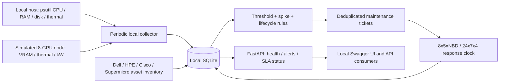

# EinWatch: Agentless Infrastructure Telemetry & TPM Lifecycle Monitor

**Local infrastructure visibility, GPU capacity signals, and actionable maintenance queues in one runnable Python service.** EinWatch demonstrates how a Third-Party Maintenance (TPM) operation can connect equipment lifecycle exposure with telemetry evidence and contract response targets.

## Executive overview

EinWatch brings together an enterprise asset inventory, OEM EOL/EOSL and warranty dates, local CPU/RAM/disk/thermal measurements, and a simulated eight-GPU rack node. Explainable rules turn thermal anomalies, capacity pressure, and lifecycle deadlines into persistent maintenance tickets. FastAPI exposes health, active alerts, and SLA compliance for operational review.

“Agentless” here means **no remote agent deployment**: the Python process measures only the machine running it. There is no fleet discovery, remote polling, network scanning, external probing, cloud telemetry, or outbound notification integration. GPU readings are synthetic. This is a local reference implementation for TPM workflows, not a production fleet monitoring platform.



## Quickstart: Windows PowerShell

Requires Python **3.10+**. Run these commands from this project directory:

```powershell
python -m venv .venv
.\.venv\Scripts\python.exe -m pip install -r requirements.txt
.\.venv\Scripts\python.exe -m pytest -q
.\.venv\Scripts\python.exe -m src.api
```

Open [interactive API documentation](http://127.0.0.1:8000/docs) or [node health](http://127.0.0.1:8000/nodes/health). The service binds to **127.0.0.1:8000**, initializes SQLite, seeds four clearly labeled demo assets, collects a first sample, and then collects every 30 seconds. Stop with Ctrl+C.

In a second PowerShell terminal:

```powershell
Invoke-RestMethod http://127.0.0.1:8000/health
Invoke-RestMethod -Method Post 'http://127.0.0.1:8000/collect?scenario=thermal_spike'
Invoke-RestMethod http://127.0.0.1:8000/alerts
Invoke-RestMethod http://127.0.0.1:8000/sla/compliance
```

To print telemetry without running the API:

```powershell
.\.venv\Scripts\python.exe -m src.collector --scenario load_spike --seed 42
```

### macOS / Linux

```bash
python3 -m venv .venv
.venv/bin/python -m pip install -r requirements.txt
.venv/bin/python -m pytest -q
.venv/bin/python -m src.api
```

The clean source delivery excludes virtual environments and caches; create `.venv` with the commands above after downloading.

## Enterprise asset and lifecycle model

SQLite stores vendor, model, serial number, warranty expiration, OEM EOL, OEM EOSL, telemetry source, lifecycle provenance, and TPM SLA tier. The demo includes Dell PowerEdge, HPE ProLiant, Cisco UCS, and a Supermicro eight-GPU server.

**All seeded model associations, serial numbers, and lifecycle dates are fictional demo inventory.** The local host's Dell label does not identify or infer the real host manufacturer. Dates are relative to the first startup and retained across restarts. HPE has an expired warranty and Supermicro has a warranty expiring in 20 days so the maintenance workflow is immediately visible. Replace these with verified contract records using `PUT /assets/{asset_id}`; no OEM dates are fetched or asserted as authoritative.

- `local_psutil`: exactly one inventory record represents this machine.
- `simulated`: generated GPU data; every sample and ticket evidence records its synthetic source.
- `inventory_only`: lifecycle monitoring without hardware readings; node health is `unmonitored`.

Asset updates require a complete validated record. Existing tickets retain the SLA tier and deadline assigned when opened; an inventory edit does not retroactively rewrite contract history.

## Telemetry and detection

| Signal | Collection and rule |
| --- | --- |
| CPU | Local utilization, sampled over 0.1 seconds; warning at ≥90% |
| RAM / disk | Local usage percentage; warning at ≥90%; disk defaults to current drive/filesystem root |
| Thermals | Available psutil sensors; critical at ≥85°C; unavailable sensors remain `null`, never fabricated |
| GPU VRAM / load | Eight simulated GPUs with 80 GiB each; warning at ≥95% utilization or VRAM occupancy |
| Power | Simulated GPU kW plus 0.45 kW node overhead; warning at ≥5.5 kW |
| Spikes | Temperature increase ≥15°C or CPU increase ≥40 percentage points against the prior sample within five minutes |
| Warranty / EOL / EOSL | Tickets at ≤30 days remaining, including expired dates; expired EOSL is critical |

The rack demonstration contains **one eight-GPU server**. Rack kW equals its node kW; it is not an estimate for an entire populated facility. Simulation modes are `normal`, `thermal_spike`, and `load_spike`. Seeded simulation is reproducible except for observation timestamps. Thresholds are explicit constants in `src/alert_engine.py`, not vendor operating limits.

Thermal support depends on the operating system and sensor drivers. No sensor support results in `thermal_available=false`. Sensors are not assumed to be CPU-only. Inventory-only assets have lifecycle alerts but no invented telemetry.

## Ticket lifecycle and SLA semantics

Rule matches generate internal SQLite maintenance tickets. Repeated matches update evidence, severity, last-seen time, and occurrence count while preserving the original deadline. A unique active `(asset_id, rule)` index prevents duplicate open tickets. Acknowledge or resolve through the API. Resolved tickets remain in history; a persistent condition can open a new ticket at the next evaluation.

Tickets **do not auto-resolve** when a sample improves. Operators verify remediation and close them explicitly. Resolving an unacknowledged ticket counts as acknowledgment at resolution time. Acknowledgment is idempotent; a resolved ticket cannot be transitioned again. No ticket is sent to an outside helpdesk.

| Tier | Explicit demo response target |
| --- | --- |
| `24x7x4` | Four elapsed hours from ticket creation, including weekends |
| `8x5xNBD` | Monday–Friday 09:00–17:00 UTC intake window; response by 17:00 UTC on the next business day after acceptance |

Before 09:00, a weekday ticket is accepted that day. At/after 17:00 or on weekends, acceptance moves to the next weekday. Example: Friday noon → Monday 17:00; Friday 18:00 → Tuesday 17:00. Holidays are not modeled. These are documented **response/acknowledgment** targets, not promises of repair completion, onsite arrival, or interpretations of a particular vendor contract.

SLA compliance counts acknowledged-on-time tickets as `met`, overdue unacknowledged tickets and late acknowledgments as `breached`, and still-in-window unacknowledged tickets as `pending`. Pending tickets are excluded from the percentage denominator; no assessed tickets yields `null`. A late acknowledgment remains breached.

## API reference

| Method | Path | Purpose |
| --- | --- | --- |
| GET | `/health` | Service/database health and last collection errors |
| GET | `/assets` | Asset inventory and lifecycle dates |
| PUT | `/assets/{asset_id}` | Create or replace a validated asset record |
| GET | `/nodes/health` | All inventory records, latest samples and active alert counts |
| GET | `/nodes/{asset_id}/health` | One asset; unknown asset returns 404 |
| POST | `/collect?scenario=normal` | Collect locally and evaluate rules immediately |
| GET | `/alerts?active_only=true` | Active tickets; set false to include history |
| POST | `/tickets/{ticket_id}/acknowledge` | Record first response |
| POST | `/tickets/{ticket_id}/resolve` | Close the ticket |
| GET | `/sla/compliance` | Per-ticket response targets and compliance rollup |

Node status is `unmonitored` without telemetry; otherwise `stale` if the latest sample is older than the greater of three collection intervals or 60 seconds, then `critical`, `warning`, or `healthy` based on active tickets. `/health` checks service/database availability; node endpoints carry hardware status. Ticket `evidence` is a JSON-encoded string in API responses.

## Storage and runtime

`data/einwatch.sqlite3` contains `assets`, `telemetry`, and `tickets`. Each operation uses its own connection with transactions, foreign keys, and a 30-second busy timeout. WAL mode supports concurrent reads. A collection lock serializes scheduled and manual collection. SQLite indexes accelerate latest-sample lookup and enforce active-ticket uniqueness.

Set `EINWATCH_DB` to change the database path. The application factory `create_app(db_path, interval_seconds=30, background=True)` supports isolated deployments and tests. Importing the API module does not create files or start collection; initialization runs during FastAPI lifespan startup. Run **one Uvicorn worker** so there is one scheduler. Telemetry history is retained without automatic pruning; size the local storage and archive data as needed.

## Docker

```bash
docker build -t einwatch-tpm-monitor .
docker run --rm --name einwatch -p 127.0.0.1:8000:8000 -v einwatch-data:/app/data einwatch-tpm-monitor
```

The image runs as an unprivileged user. Inside the container Uvicorn binds to `0.0.0.0` so Docker can forward the port; the shown host mapping exposes it only on loopback. A named volume preserves SQLite. Container-visible psutil values reflect the host/kernel and container filesystem visibility; they are not guaranteed to equal container CPU/memory quotas. GPU data remains simulated. No privileged mode, host device access, or remote host connection is required.

The API has no authentication and is intended for local use. Keep the default loopback binding. Dependencies are downloaded during installation/image build; runtime collection has no outbound network calls.

## Verification and source layout

`tests/test_einwatch.py` exercises real local collection, unsupported sensors, deterministic eight-GPU simulation, asset validation, lifecycle rules, threshold/spike detection, ticket deduplication, business-day deadlines, acknowledgment/breach behavior, persistence, and API endpoints with FastAPI's in-process test client. Tests use temporary SQLite files, with no live external services. Pytest temporary files are kept inside `.pytest_cache`.

```text
src/collector.py       Local psutil readings and simulated GPU node
src/models_and_db.py   Asset validation and SQLite persistence
src/alert_engine.py    Anomaly rules, ticket creation, response SLA clocks
src/api.py             FastAPI endpoints and periodic collection
tests/test_einwatch.py Unit and integration tests
data/.gitkeep          Runtime database directory
Dockerfile            Non-root, single-worker container
requirements.txt      Runtime and test dependencies
```

Implementation references: [psutil API](https://psutil.io/api/), [FastAPI testing](https://fastapi.tiangolo.com/tutorial/testing/), and [FastAPI lifespan testing](https://fastapi.tiangolo.com/advanced/testing-events/).
