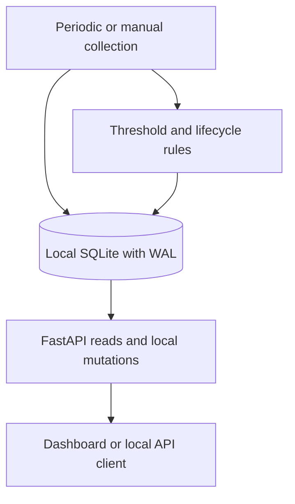
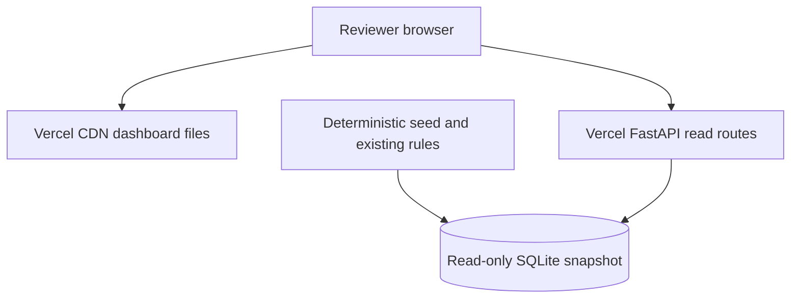

# EinWatch architecture and baseline audit

The first milestone extends the existing local monitoring service with a read-only dashboard and API on Vercel, backed by a deterministic hardware monitoring scenario. A recruiter can inspect telemetry, trace a thermal alert to its response target, and browse API contracts from a browser.

## Original repository audit

Baseline `668400e` contained one upload commit, four Python modules, one integration/unit suite, a Dockerfile and a README. Running the original dependencies and suite on Python 3.12 produced 21 passing tests and one HTTP test-client deprecation warning.

| Area | Baseline evidence | Milestone response |
| --- | --- | --- |
| Architecture | FastAPI managed startup, one periodic collector, SQLite and a synchronous rules engine. psutil reads only the hosting machine. The eight-GPU node is simulated. | Preserve the local entry point and share a read router with a separate hosted entry point. |
| Data | Assets, telemetry and tickets persist locally. Foreign keys, WAL and a partial unique active-ticket index were present. Telemetry rows already had an asset/ID index. | Use that index for bounded history and verify the SQLite query plan. |
| API | Inventory, manual collection, current health, alerts and acknowledgment endpoints existed. No telemetry history, dashboard, or HTTP availability monitoring existed. | Add history, dashboard and documented API query behavior. |
| Security | Local mutations lacked authentication. Local telemetry can expose disk paths and sensor information. A competing ticket transition could read stale state before updating. | Keep the local app loopback-first. Preview registers only reads, uses a read-only fixture database, and never runs the host collector. Serialize ticket transition read/write transactions. |
| Reliability | Unit and API tests covered local measurement, synthetic scenarios, thresholds, SLA rules, persistence and scheduled collection. No CI or hosted verification. | Add CI plus API, pagination, concurrency and hosted-mode regression cases. |
| Dependencies and deployment | Broad package ranges and runtime-installed test dependencies. The local Docker setup had no hosted entry point. | Pin observed compatible versions, move test dependencies into their own file, and configure an explicit Vercel entry point. |
| Technical debt | Alert history and SLA reporting read all matching tickets. Node health still queries latest sample per asset. No retention policy or database migrations. | Fetch active tickets once for overview. Track retention, migrations and bounded alert responses in the backlog. |

## Local operation

`src/api.py` starts FastAPI’s lifespan, creates the database, seeds inventory, collects the initial batch, then schedules one background task. A process-local lock serializes local collection and asset changes. `src/collector.py` reads psutil and generates simulated GPU samples. `src/alert_engine.py` evaluates each sample, deduplicates active findings, and computes response SLA deadlines. Manual or periodic collection is a multi-step operation, so a failure can leave a sample committed before all ticket updates complete.

## Hosted preview

`app.py` registers only the read router and demo health route. `src/demo.py` uses a fixed date, 48 GPU samples, known spike scenarios and the existing rules to build a snapshot on first API access. Each function process can reconstruct the same state in its writable temporary directory. Reads then use SQLite `mode=ro`. Demo SLA calculations use the snapshot time so the examples remain meaningful after deployment. No database credentials or scheduler are required.

## Database structure

| Table | Key relationships and indexes |
| --- | --- |
| `assets` | Text primary key, lifecycle dates, provenance, telemetry source and SLA tier |
| `telemetry` | Integer sample ID, asset foreign key, UTC observation time, source and source-specific JSON. Index on asset and descending ID covers cursor queries. |
| `tickets` | Integer ticket ID, asset foreign key, rule, timestamps, evidence, status and SLA tier. Partial unique index enforces one active ticket per asset and rule. |

## Decisions and scaling trade-offs

- Keep SQLite for both local use and synthetic preview. Local SQLite is simple to install and persists on a local disk or Docker volume. The hosted function may be replaced, so its database is only a reconstructible snapshot. Shared Postgres is deferred until hosted mutable records justify migrations, credentials and cross-instance persistence.
- Use insertion-ID cursors instead of offset pagination. The existing index supports a targeted range scan and the cursor is stable under appends. If users later need ordering by observation time, add an observation-time index and use a composite cursor with the ID as a tie-breaker.
- Use browser-native HTML, CSS, JavaScript and Canvas. This avoids a separate frontend build and reduces dependencies. The chart displays the current page and the table retains exact values and provenance. A framework or chart library becomes relevant when richer workflows justify the build and bundle cost.
- Keep the hosted app read-only. Publishing the original local API would expose host data and unauthenticated mutations. Hosted writes need an authenticated boundary, authorization tests and a separate persistent store.
- Hosted app failures can be investigated through platform function logs. There is no error-tracking provider, alert delivery, uptime collector or recurring deployment health check in this milestone. The [backlog](https://github.com/YushayAizaz/einwatch-tpm-monitor/issues) carries that work.

## Prioritized backlog

1. [Durable monitoring and authenticated ingestion](https://github.com/YushayAizaz/einwatch-tpm-monitor/issues/1) for one owner-controlled service.
2. [Incident observability and notification delivery](https://github.com/YushayAizaz/einwatch-tpm-monitor/issues/2) and [retention and bounded operational views](https://github.com/YushayAizaz/einwatch-tpm-monitor/issues/4).
3. [Reliability views and portfolio integrations](https://github.com/YushayAizaz/einwatch-tpm-monitor/issues/3), once the individual services have verified health endpoints.
